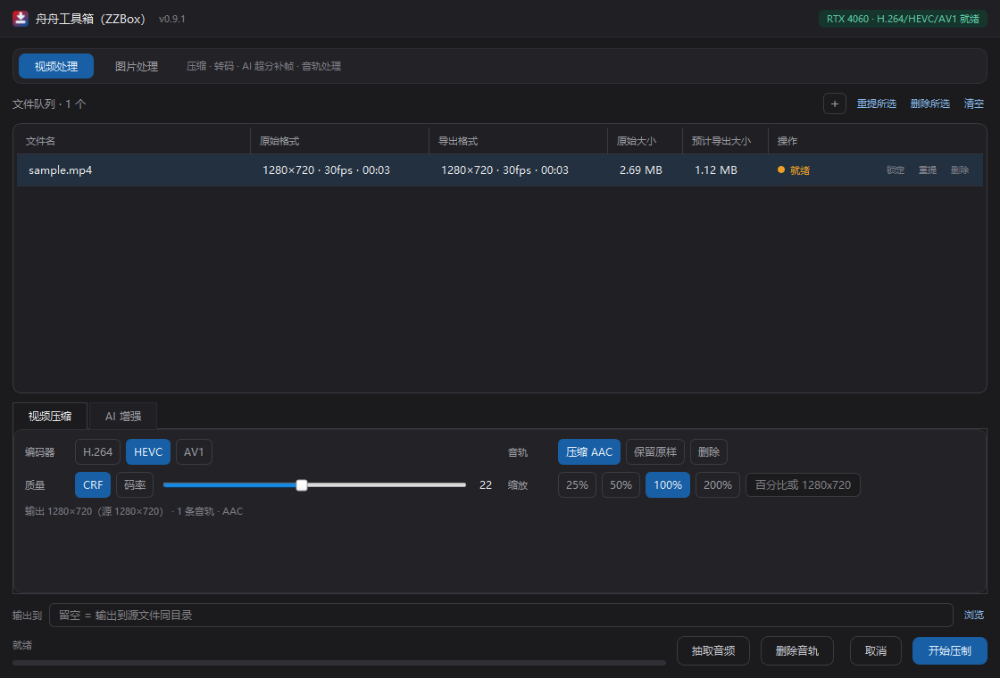
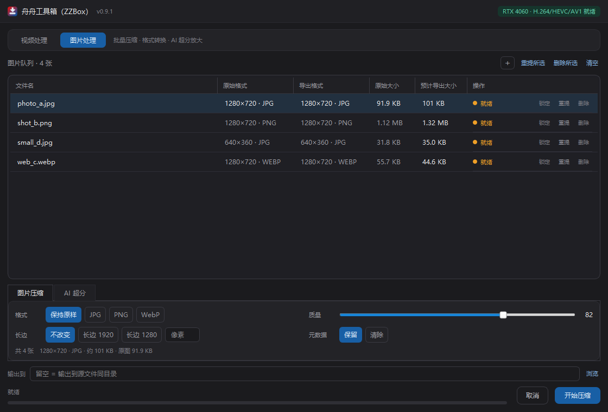
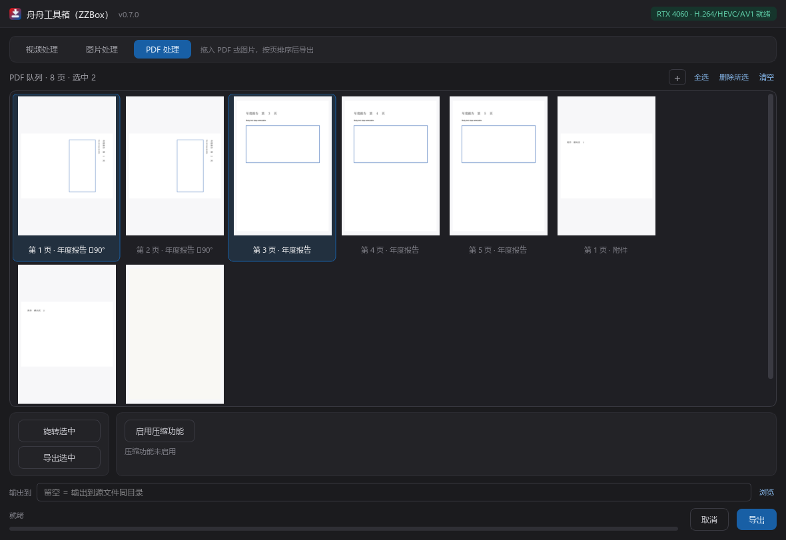

<div align="center">


# 舟舟工具箱 · ZZBox

**视频转码 · 图片处理 · PDF 整理，三个工作台，一套本地引擎**

把文件拖进来，点一下。视频交给显卡压小、抽音轨、超分补帧；图片批量改格式、压体积、放大两到四倍；
PDF 一格一页地重排、合并、拆页，压缩只换图片不动文字。

[](../../releases)
[](#系统要求)
[](https://www.python.org/)
[](LICENSE)

</div>

| 视频处理 | 图片处理 | PDF 处理 |
|:---:|:---:|:---:|
|  |  |  |
| 队列在上、参数在下，改一个参数整列当场重算 | 同一套布局，图片按张统计体积与耗时 | 一格一页，拖动排序后导出 |

---

## 这是什么

一个纯本地运行的 Windows 桌面工具。顶部三个工作台 —— **视频处理**、**图片处理**、**PDF 处理** ——
各自一份队列、一套参数，互不干扰。

- **不联网**。不上传文件，不进云端队列，处理完就落盘
- **不需要装 Python / FFmpeg**。下载解压，双击 `ZZBox.exe`
- **关掉窗口不等于退出**。程序缩到托盘继续跑，做完弹一条通知

适合这些活：素材归档前瘦身、4K 素材转 1080p 交付、批量压访谈和课程视频、把视频里的音轨单独抽出来；
手机相册几十张照片压到能发出去的大小、老照片和截图放大两倍再打印；
一堆扫描件和截图拼成一份 PDF、从大手册里挑几章单独导出、把扫歪的页面转正。

---

## 下载

到 [Releases](../../releases) 页面下载。自己出包就跑 `python tools/make_zips.py`。

解压后双击 `ZZBox.exe`。整个文件夹可以拷到 U 盘或别的电脑直接用，不写注册表。

---

## 快速开始

1. 解压后双击 `ZZBox.exe`（或 `启动.bat`）
2. 顶部选 **视频处理** / **图片处理** / **PDF 处理**
3. 把文件拖进窗口，或点队列右上角的 `+`
4. 在下方参数区调好设置，点右下角的「开始压制」「开始压缩」「导出」之类

进度条显示百分比、加速倍率和剩余时间；做完状态圆点变绿，托盘弹通知。

逐项操作的手册见随包附带的 [README.txt](README.txt)。

---

## 视频处理

### 硬件编码

解码走 CPU，编码交给显卡（NVENC）。三档编码器的体积差异大致如下：

| 编码器 | 同画质下的体积 | 显卡要求 |
|---|---|---|
| H.264 | 100%（基准） | GTX 10 系及以上 |
| HEVC | 约 88% | GTX 10 系及以上 |
| AV1 | 约 75% | RTX 40 系及以上 |

全 GPU 管线（硬解 + 显存内缩放）还没做，解码这一半仍占 CPU。

### 队列：先告诉你多大，再开始压

队列表格六列，改任何参数都会当场重算：

| 文件名 | 原始格式 | 导出格式 | 原始大小 | 预计导出大小 | 操作 |
|---|---|---|---|---|---|
| 项目汇报_终版.mp4 | 1920×1080 · 25fps · 03:29 | 1280×720 · 25fps · 03:29 | 265 MB | 143 MB | ● 已压制 |

「预计导出大小」不是拍脑袋：按 CRF 与分辨率反推码率，系数用实拍素材标定过，六组设置回测误差都在 1% 内。
同类素材实拍会有 ±25% 浮动，码率模式下最准。

### 音轨工具（批量）

- **抽取音频** — 导出 `.m4a`
- **删除音轨** — `-map 0:v:0 -c:v copy -an`，视频流原样拷贝，**一帧都不重编**，几秒钟出结果

两个都是批量的：选中几行就处理几行，没选就整队。

### AI 增强：超分 · 补帧

页签切到「AI 增强」。它和「视频压缩」是两套独立参数，但共用同一个文件队列 ——
一个片子可以先超分，再拿去压。

- **超分** — 关闭 / 2× / 3× / 4×。**输出尺寸只有一个来源：源尺寸 × 倍率。**
  没有并排的「输出分辨率」下拉，那种双旋钮看着像两个功能，实际会互相吃掉
  （选 2× 配 1080p 上限得到 1.5×，配 4K 上限又完全没用），用户没法预测结果。
  720p 选 2× 就是 1440p，选 4× 就是 2880p
  - **真人实拍**（`realesrgan-x4plus`，默认）— RRDB 深度网络，约 1670 万参数，
    能重建皮肤纹理、发丝分层、镜架金属感。固定 4× 推理，再 lanczos 降到你要的尺寸。
    **慢：720p 素材约 6 秒/帧（RTX 4060）**
  - **动画番剧**（`realesr-animevideov3`）— SRVGGNet 轻量架构，只有 1.4 MB / 约 60 万参数，
    快 5 倍。它的训练集全是动画帧，**拿去处理真人会把皮肤抹成色块、眼睛描成卡通线条**
- **补帧** — 2× / 4×，RIFE 光流插帧，只改帧率不改时长，音轨原样保留
- **降噪** — 关闭 / 轻度 / 较强。低码率视频的退化是「压缩块 + 振铃」，直接超分等于把这些伪影
  一起放大 4 倍；先轻度去噪再超分，细节更干净而不是更少
- **锐化** — 关闭 / 轻度 / 较强，默认轻度。4× 重建后降到目标尺寸，边缘会软一档，
  补一点 unsharp 拉回来；放到「较强」会开始出白边
- **推荐档位** — 鼠标停在倍率按钮上，按当前素材和显卡算出「这一档得到多大、推理面积多少 MP、
  显存够不够」，推荐的那一档标 ★。判据是「把高度补到 1440p 附近」，1080p 源在 8G 卡上
  会直接建议不放大（那是 33 MP 推理）
- **显存自适应** — 按显存决定分块大小。倍率降不下来时（x4plus 只有 4×）靠缩小 tile 兜住显存，
  而不是硬跑一个 OOM
- **临时空间警示** — 面板底部一行橙色提醒写清「这次会在哪个盘产生多少 GB、该盘还剩多少、
  为什么别把输出放系统盘」。超分要落盘一堆中间帧，1 分钟 720p 的 2× 就要约 39 GB

#### 推理倍率和输出倍率是两件事

这是最容易误解的地方。`realesrgan-x4plus` 只有 4× 一档，但选 2× 时**不会**得到一个 4× 的片子：

```
你选 2×  →  引擎按 4× 推理到 2880p  →  lanczos 降到 1440p  →  输出 1440p
```

多出来的一步不是浪费，是**超采样**：先在 4 倍尺度上重建细节，再缩回去，锐度明显好于任何原生
2× 模型。这也是它值得慢 5 倍的原因。

另一处顺序上的讲究：补帧放在降采样**之后**。先在 2880p 上插帧再缩，RIFE 要多算 4 倍像素，
插出来的中间帧还得跟着缩一次 —— 白花时间，边缘反而更糊。

| 显存 | 720p 素材能做什么 | 体验 |
|---|---|---|
| 6 GB | 2× (1440p)、3× (4K) | 能用，4× 会切小分块变慢 |
| 8 GB | 2× / 3× / 4× 都可以 | 甜点区 |
| 12 GB+ | 1080p → 4K | 舒服 |

引擎是 **Vulkan 后端**的 ncnn 版本：不需要装 CUDA、不需要 Python、不需要配环境变量，解压即用。
代价是没用 TensorRT，速度不是极限。

> **速度要有心理准备**：实拍模型在 RTX 4060 上约 6 秒/帧，1 分钟 720p（24fps）要 2.5~3 小时。
> 界面上的「预计耗时」按这张卡的实测基准估算，别的卡会差不少。只补帧不超分很快
> （1 分钟素材约 1 分钟），嫌慢可以先只补帧。

> **效果预期（说实话版）**：720p → 1440p 用实拍模型，皮肤纹理和发丝是能真的回来的；
> 720p → 4K 的细节仍有相当一部分是模型「猜」的，人脸、文字、细纹理最容易翻车。
> 动画和 AI 生成素材可以直接冲 4K，真人实拍建议停在 1440p。

#### 色彩这条路是怎么走的

中间产物是 PNG 序列，而 PNG 不带色彩标签，所以两端的转换必须在命令行里写死，不能交给 ffmpeg 自动协商：

```
源(yuv420p) --拆帧-- RGB PNG --超分/补帧-- RGB PNG --合成-- 输出(yuv420p)
             bt709/tv 转换                           bt709/tv 转回
```

拆帧时用 `scale=in_color_matrix=…:in_range=…` 固定 YUV→RGB 的系数，合成时用
`scale=out_color_matrix=…:out_range=…` 按同一套转回来，并把 `-colorspace` / `-color_primaries` /
`-color_trc` 写进码流。**两次矩阵不一致，肤色就会整体跑偏**；源文件没写色彩标签时按分辨率推断
（≥720p 用 bt709，SD 用 bt601）。

另一半是像素格式：合成时必须显式 `-pix_fmt yuv420p`。PNG 是 RGB，而 NVENC 支持 HEVC Rext 的
`gbrp`，ffmpeg 会自动协商成「RGB 直编」—— 产出的文件尺寸、帧率、时长全对，但绝大多数播放器
把 G/B/R 三个平面当成 Y/U/V 解释，画面就成了**整体绿配品红**（白色变粉紫、暗部变绿）。
这是个光看元数据发现不了的坑，所以 `tools/check_color.py` 把像素格式和逐帧 RGB 均值都纳入了检查。

---

## 图片处理

### 批量压缩

队列和视频那边长得一样（文件名 / 原始格式 / 导出格式 / 原始大小 / 预计导出大小 / 操作），
参数面板也是同一套布局。四个参数：

| 参数 | 选项 | 说明 |
|---|---|---|
| 格式 | 保持原样 / JPG / PNG / WebP | 保持原样 = 每张图按自己的格式走，只改质量和尺寸 |
| 质量 | 40–100 滑块，默认 82 | JPG 与 WebP 有效；PNG 无损，这个值不参与 |
| 长边 | 不改变 / 1920 / 1280 / 自定义 | 只缩不放，等比缩放，输出边长对齐到偶数 |
| 元数据 | 保留 / 清除 | 清除会去掉 EXIF、拍摄时间、GPS 和相机型号 |

- **透明通道自动处理**：源图带 alpha 时，PNG 和 WebP 保留透明；转 JPG 时先把透明区摊到白底上，
  不会拿到一张黑底图
- **手机竖拍照片按你看到的方向转**：EXIF 里记着「转 90°」的照片，输出是正的，不是躺倒的
- 一张图 0.1 秒左右，几百张也就几分钟

### AI 超分

同一个 `realesrgan-ncnn-vulkan` 引擎，同一套模型体系（真人实拍 / 动画番剧）。区别是图片本来就单帧，
引擎直接吃文件 —— 不用拆帧、不占临时空间、没有中间帧序列。

- 倍率 2× / 3× / 4×，格式跟随源或指定 JPG / PNG / WebP
- 和视频页共用降噪、锐化两档开关，语义完全一样
- **推理倍率和输出倍率同样是两件事**：实拍模型只有 4× 一档，选 2× 时它按 4× 推理再降到 2× 尺寸
- RTX 4060 上 1280×720 的图约 8 秒一张，1080p 约 18 秒

> 图片走的是「引擎出 PNG → ffmpeg 缩放/锐化/编码」两步。中间刻意用 PNG：引擎也支持直接出 JPG，
> 但那一步会把刚重建出来的细节再压掉一次，后面降采样时就看不出超分带回了什么。

---

## PDF 处理

### 一格一页

PDF 工作台的队列换了形态：**一格是一页，不是一个文件**。一份 80 页的扫描件拖进来就是 80 格，
一张图片也是一格。所以「合并」「拆页」「挑几页单独导出」在这里是同一个动作 —— 对着页面把顺序排好，导出。

| 想干的事 | 怎么做 |
|---|---|
| 几十张图合成一个 PDF | 全拖进来，拖好顺序，点「导出 → 合并为 1 个 PDF」 |
| 多个 PDF 拼成一份 | 同上，PDF 和图片可以混在一个队列里 |
| 拆成单页 | 「导出选中 → 导出为多个 PDF（每页一个）」，或导出成 PNG / JPG |
| 从大文件里挑几章 | 只选那几格，「导出选中 → 1 个 PDF」 |
| 按来源分开导出 | 「导出 → 按来源分别导出多个 PDF」，同一份源文件的页面归到一起 |
| 扫歪的页面转正 | 选中后点「旋转选中」，再点继续叠加 90° |

### 导出：文件名跟着原文件走

单页导出（每页一个文件）的命名规则：

| 来源 | 导出的单页文件 |
|---|---|
| `年度报告.pdf` 的第 3 页 | `年度报告·3.pdf` / `年度报告·3.png` |
| `票据扫描.jpg`（本来就是一页） | `票据扫描.png` —— 图片不带页号 |
| 同一页又导一次 | `年度报告·3(2).png` —— 重名自动挂序号，不覆盖上一次的成果 |

页号取的是这页在**原始文件**里的位置，不是队列里的位置。拆出去再拼回来时，看名字就知道它原来在第几页。

导出成图片时，文件会进一个 `源名_png_时间` 的子目录，免得和原文件混在一起；导出成 PDF 时直接落在
「输出到」目录里。

> **导出选中和合并不会重新渲染。** 走的是 PDF 页面对象级搬运，文字层、矢量、链接、表单、书签全都留着
> —— 导出的 PDF 照样能搜索、能复制。JPEG 图片也是原样嵌进去（`DCTDecode`），一个像素都不重算。

### 下方工作区分成两块

| 区域 | 放什么 | 管什么 |
|---|---|---|
| 左（窄） | 「旋转选中」「导出选中」 | 只动**选中的页面**，永远可用 |
| 右（宽） | 压缩区，**默认关闭** | 只管**压缩**，按质量重编码页面里的图片 |

格子墙的操作：

| 操作 | 怎么做 |
|---|---|
| 多选 | 单击、Shift 连选、Ctrl 加选 |
| 排序 | 按住格子拖到新位置，落点会出现一条插入竖线 |
| 缩放 | Ctrl + 滚轮（92–268 px） |
| 删页 | 选中后「删除所选」，只动队列，源文件不碰 |

### 压缩：只换图片，不动页面

这一版的压缩和「把整页拍平成图片」是两件完全不同的事：

| | 重渲染（旧做法） | 本版做法 |
|---|---|---|
| 页面尺寸 | 会变 | **不变** |
| 文字层 | 变成图片，不能搜 | **原样保留，照样能搜能复制** |
| 图片 | 整页重画 | 只把图片的像素按质量重新压一遍 |
| 图片像素宽高 | 会缩 | **不变**，只降 JPEG 质量 |
| 链接 / 书签 / 表单 | 全丢 | 保留 |

做法是找到页面里 `/Subtype /Image` 的对象，用 Pillow 重新编码成 JPEG（`quality` = 滑块值），
再把新的字节塞回原对象。页面内容流一个字节都没动，所以图片在页面上的位置、大小、旋转全都不变。

参数只剩**质量**一项（30–100，默认 78）。格式、长边这些上一版有，这一版拿掉了：既然图片像素尺寸
必须原样保留，能调的也就只有 JPEG 质量。

**压缩区有四个状态，默认是关的：**

```
未启用      [启用压缩功能]                压缩功能未启用
选方式      [压缩部分] [压缩全部]  ← 退出压缩
压缩全部    ────质量──78──── [78]          导出时才压        ← 退出压缩
压缩部分    [压缩选中] ────质量──78── [78]  只压选中的页      ← 退出压缩
```

- **压缩全部** — 队列里每格下面显示「图片 1.4 MB → 491 KB」，**点导出时才真正压**。
  不想要就「← 退出压缩」，队列回到原始状态
- **压缩部分** — 只给选中的页面算预估，点「压缩选中」立刻压，结果放在临时目录里，压完压缩区自动
  回到未启用。之后导出直接拿这些临时文件用，不会重复计算
- 质量条拖到新值，之前压好的临时结果自动作废 —— 否则导出会用上旧质量的图，而你完全看不出来

预估是真解码、真编码算出来的，不是公式估的；同一张图被多页复用时只算一次。文件多的时候估算在后台跑，
界面不卡，数字一格一格跳出来。

### 哪些图会被跳过

宁可少压，也不压坏：

- 带透明通道的（`/SMask`）—— JPEG 存不了 alpha
- 蒙版图、带自定义 `/Decode` 映射的 —— 重编码会变色
- 解不开的（JPEG2000、CMYK、Separation）—— 交给系统查看器原样显示
- 已经很小的图 —— 再压只会更糊还更大

---

## 三个工作台怎么切

顶部的「视频处理 / 图片处理 / PDF 处理」就是分界。三边的队列、参数、状态**完全独立**：

- 拖视频进来 → 进视频队列；拖图片进来 → 进图片队列；拖 PDF 进来 → 自动切到 PDF 工作台
- 站在 PDF 工作台时，拖进去的东西一律进 PDF 队列（连图片也是）—— 你已经在这个页面上了，
  再把图片塞进图片工作台等于让你自己再找一遍
- 「输出到」三个工作台共用，切过去不用重填
- 进度条、取消、开始按钮共用一套 —— 前三者都吃 GPU，同一时刻只跑一件，串行更稳
- 视频页签里的操作（抽取音频 / 删除音轨）只在视频工作台出现

## 操作手感

- 表头拖列宽，和文件资源管理器一致（拖谁就动谁，右边的列整体平移）
- 单击选中、Shift 连选、Ctrl 加选，还能在下方空白处拉框框选
- 按住行上下拖可以调整压制顺序
- 处理完的绿点会写明是「已完成压制」「已抽取音频」还是「已删除音轨」

---

## 系统要求

- Windows 10 / 11 64 位
- **PDF 处理和图片压缩不需要显卡**，纯 CPU，什么机器都能跑
- 视频硬编码要 NVIDIA 显卡（GTX 10 系及以上；AV1 编码需要 RTX 40 系）+ 较新驱动
- AI 增强额外要求：显卡支持 Vulkan（RTX 20 系及以上都行），显存 6 GB 起；
  临时帧序列要占几 GB 到几十 GB 磁盘

---

## 常见问题

**双击 `启动.bat` 提示找不到 ZZBox.exe？**
先确认 `ZZBox.exe` 和 `启动.bat` 在同一个文件夹里。这个脚本先在当前目录找，找不到才去翻
`ZZBox vX.Y.Z` 这样的子文件夹（老版本包的布局）。实在不行直接双击 `ZZBox.exe`。

**PDF 压缩后体积几乎没变？**
说明这一份没什么可压的：纯文字页没有图片，页面上图片本来就只有几十 KB，或者图片全被跳过规则挡住了。
压缩只对**页面里的图片**生效，不会重画页面。

**PDF 能转成 Word 吗？**
不能，也不打算做。真正「可编辑且版式还原」需要版式重建 + 字体映射，是另一个量级的产品；能走通的
降级路线（整页图片、文字重排）导出来都不能用。本项目的 PDF 能力集中在页面级的整理与搬运。

**为什么单页文件名带 `·3`？**
3 是这页在**原始文件**里的页号。队列里怎么排序都不影响它，方便拆完再按名字拼回去。

**超分为什么这么慢？**
实拍模型约 6 秒/帧（RTX 4060），1 分钟 720p 要 2.5~3 小时。这是模型量和 Vulkan 后端共同决定的，
不是配置问题。只补帧不超分快得多。

**处理到一半能暂停吗？**
不能，只能取消整个队列。队列本身是串行的 —— GPU 并发跑多个任务反而更慢。

**关掉窗口还在跑？**
对，程序缩到托盘继续工作，做完弹通知。要真退出，右键托盘图标选退出。

---

## 从源码运行

```bash
git clone https://github.com/<你的用户名>/ZZBox.git
cd ZZBox
pip install -r requirements.txt

# 把 ffmpeg.exe / ffprobe.exe 放进 bin\ 目录（或确保它们在 PATH 里）
# AI 增强还需要 bin\ai\ 下的两个引擎，见下方「AI 引擎怎么装」
python main.py
```

FFmpeg 建议用 [gyan.dev](https://www.gyan.dev/ffmpeg/builds/) 的 essentials 版，或
[BtbN](https://github.com/BtbN/FFmpeg-Builds/releases) 的 win64-gpl 版。

### AI 引擎怎么装

两个引擎都是免安装的压缩包，解开后按下面的结构摆放即可（`bin\` 已被 `.gitignore` 排除，
所以仓库里没有，需要自己下）：

```
bin/ai/
├── esrgan/
│   ├── realesrgan-ncnn-vulkan.exe
│   ├── vcomp140.dll
│   └── models/                     ← realesr-animevideov3-x2/x3/x4、realesrgan-x4plus
└── rife/
    ├── rife-ncnn-vulkan.exe
    ├── vcomp140.dll
    └── rife-v4.6/                  ← 模型目录，直接放 exe 旁边
```

下载地址：

- 超分：[Real-ESRGAN releases](https://github.com/xinntao/Real-ESRGAN/releases) →
  `realesrgan-ncnn-vulkan-*-windows.zip`
- 补帧：[rife-ncnn-vulkan releases](https://github.com/nihui/rife-ncnn-vulkan/releases) →
  `rife-ncnn-vulkan-*-windows.zip`

放好之后打开程序，切到「AI 增强」页，「引擎与开销」卡片会显示「超分 就绪 · N 个模型」「补帧 就绪」。
缺了不影响普通压制，点开始时会弹窗告诉你缺哪个。

想确认装对了，跑一条命令就够：

```bash
python tools/test_ai_pipeline.py
```

它会自己造一段 3 秒测试片，走完整个管线，最后打印成片的尺寸 / 帧率 / **颜色偏差**。颜色是单独一项硬检查：
输出像素格式必须是 YUV 系，逐帧 RGB 均值差不得超过 16 级 —— 尺寸帧率都对但画面绿成一片的那种毛病，
只有这项能拦住。

想单独验某个片子的颜色：

```bash
python tools/check_color.py 源.mp4 输出.mp4
```

---

## 自己打包

```bash
python build.py
```

产物落在仓库上一级的 `zz box 0.7.0\`，里面是完整可运行目录（PyInstaller onedir 模式，比 onefile
启动快得多），`bin\` 下的 FFmpeg 与 AI 引擎会一并带上。想换位置就传一个路径：
`python build.py "D:\some\where\ZZBox"`。

打完必须验一遍：

```bash
"zz box 0.7.0\ZZBox.exe" --selftest --quiet
```

结果写在同目录的 `logs\selftest.txt`，最后一行是 `RESULT = PASS`。它会真跑一段转码、一次图片压缩、
一次图片超分，还有 PDF 合成与 PDF 图片压缩 —— 后者专门用来验证 `pypdf` 和 `pdfium.dll` 有没有被
PyInstaller 漏收。

---

## 目录结构

交付时是两个并列文件夹：

```
gpu-video-encoder/
├── zz box 0.7.0/        成品：ZZBox.exe + _internal/ + bin/（FFmpeg 与 AI 引擎）+ licenses/
└── zz box code/         纯源码，不含 bin/ 与构建产物
```

源码内部：

```
ZZBox/
├── main.py                 程序入口，含 --selftest 自检（视频 + 图片 + PDF 各跑一遍）
├── build.py                PyInstaller 打包脚本
├── app/
│   ├── core/
│   │   ├── probe.py        找 FFmpeg、读显卡、真跑一次编码验证可用性
│   │   ├── media.py        ffprobe 解析、格式化（分辨率·帧率·时长、体积）
│   │   ├── encoder.py      命令行构造、体积估算、缩放计算
│   │   ├── runner.py       单进程执行、ffmpeg 进度解析、取消
│   │   ├── ai.py           AI 增强：引擎探测、显存档位、四段管线编排
│   │   ├── ai_runner.py    多阶段执行器（数帧数 + ffmpeg 进度，加权汇总）
│   │   ├── image.py        图片：探测、格式/质量/缩放、超分命令、体积估算
│   │   ├── image_runner.py 图片执行器（1~2 步命令链，解析引擎百分比）
│   │   ├── pdf.py          PDF：页面探测、渲染、无损组装（pdfium）、单页命名
│   │   ├── pdf_images.py   PDF 图片压缩：重编码页面内嵌图、保留文字层（pypdf）
│   │   └── pdf_runner.py   PDF 执行器（线程 + 协作式取消，无子进程可管）
│   └── ui/
│       ├── main_window.py  主窗口、三个工作台、参数页、任务调度
│       ├── widgets.py      队列表格、集成化参数面板、属性页页签
│       ├── page_grid.py    PDF 页面格墙（多选 / 拖动排序 / Ctrl+滚轮缩放 / 尺寸行）
│       ├── tray.py         托盘与后台驻留
│       ├── style.py        深色主题 QSS
│       └── icons.py        多尺寸图标加载
├── assets/                 图标（SVG / 多尺寸 PNG / ICO）、版本资源
├── bin/                    ffmpeg.exe / ffprobe.exe（不入库）
│   └── ai/                 两个 ncnn 引擎，各自带 models
├── docs/                   设计文档与截图
└── tools/
    ├── make_icon.py        从 SVG 生成全部尺寸图标与 ICO
    ├── make_zips.py        打 full / lite 两个发布包
    ├── shot_ui.py          给各属性页各截一张图
    ├── test_ai_pipeline.py AI 管线端到端回归测试
    ├── test_pdf_core.py    PDF 核心逻辑回归（文字层、旋转、无损组装、单页命名）
    ├── test_pdf_images.py  图片压缩回归（文字层 / 页面尺寸 / 图片像素全不变）
    ├── test_pdf_ui.py      PDF 工作台离屏实跑 + 截图 + 导出命名验证
    ├── test_pdf_zip_ui.py  压缩区四态实跑（启用 → 全/部分 → 暂存 → 导出）
    └── test_page_grid_drag.py  格墙拖动排序（纯鼠标事件）
```

---

## 已知限制

- 解码用 CPU、编码用 GPU，没有做硬解和显存内缩放
- HDR / 10bit 素材会被转成 8bit，颜色可能偏差
- 队列串行，同时只处理一个文件
- 没有暂停，只能取消整个队列
- 只做了 NVIDIA 路径（NVENC），AMD / Intel 的硬编码没有适配
- AI 增强逐帧处理且中间产物必须落盘（引擎只吃图片目录）：1 分钟 720p 超分 2× 峰值约
  25~40 GB 临时空间（按 4× 推理尺寸算，比输出大 4 倍），1080p 源更高
- 补帧只能整数倍（2×/4×），24fps → 60fps 这种非整数倍不支持
- 输出尺寸严格等于「源 × 倍率」，超过 4K 只提示不拦截
- AI 增强的输出固定为 8bit `yuv420p`，HDR 素材的色彩无法保留；普通压制按源的位深走
- 图片不支持动图：GIF 会被静默压成第一帧，所以干脆不在支持列表里
- 图片超分没有做分块尺寸自适应，8000 万像素以上的输出可能撞显存上限
- 图片队列与视频队列各自独立，不能混排成一条流水线
- PDF 压缩只作用于**图片**：纯文字页压了等于没压
- PDF 压缩后图片像素尺寸不变（只降 JPEG 质量），体积不会像整页重渲染那样一降到底
- PDF 不支持带打开密码的文件，也不做加密导出
- PDF 不做 OCR、不做文字编辑、不转 Word —— 那是另一个量级的产品
- PDF 队列里同一页可以导入两次（拼版时有这个需求），代价是缩略图各渲染一遍
- PDF 导出不保留书签目录：页面被重排后原页码已经对不上，硬搬反而指错地方

---

## 关于 FFmpeg 与开源协议

**本项目自己的代码是 [MIT](LICENSE)。** 内置的 FFmpeg 是独立程序，通过命令行调用，两者不构成衍生作品。

内置的是 [gyan.dev](https://www.gyan.dev/ffmpeg/builds/) 的 `ffmpeg 7.1-essentials_build`，编译时带了
`--enable-gpl --enable-version3 --enable-libx264 --enable-libx265 --enable-libaom`，因此是 **GPLv3** 授权。
分发时已随包附上许可证全文与源码获取方式，见 [THIRD-PARTY-NOTICES.md](THIRD-PARTY-NOTICES.md)。

PDF 部分刻意没有用 PyMuPDF（AGPL，会把整个项目的授权传染掉），页面搬运靠 `pypdfium2`（Apache-2.0 /
BSD-3），图片重编码靠 `pypdf`（BSD-3）与 Pillow（MIT-CMU）。

如果你要二次分发：请一并保留 `licenses/` 目录，并保证能提供对应版本的 FFmpeg 源码（直接给 gyan.dev 的
下载链接也算书面 offer）。想彻底免掉这个义务，就让用户自己准备 FFmpeg。

---

## 致谢

- [FFmpeg](https://ffmpeg.org/) — 所有转码能力的底座
- [Qt for Python (PySide6)](https://doc.qt.io/qtforpython/) — 界面
- [gyan.dev](https://www.gyan.dev/ffmpeg/builds/) — Windows 版 FFmpeg 构建
- [PDFium](https://pdfium.googlesource.com/pdfium/) / [pypdfium2](https://github.com/pypdfium2-team/pypdfium2) — PDF 渲染与页面搬运
- [pypdf](https://github.com/py-pdf/pypdf) — PDF 对象流改写
- [Real-ESRGAN](https://github.com/xinntao/Real-ESRGAN) — 超分模型与 ncnn 实现
- [RIFE](https://github.com/hzwer/ECCV2022-RIFE) / [rife-ncnn-vulkan](https://github.com/nihui/rife-ncnn-vulkan) — 补帧
- [ncnn](https://github.com/Tencent/ncnn) — 两者的推理框架，Vulkan 后端让工具免装 CUDA
