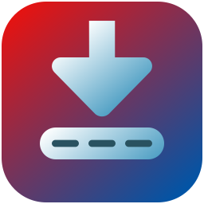
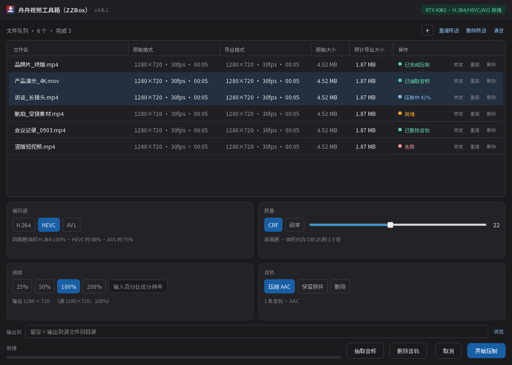

<div align="center">



# 舟舟视频工具箱 · ZZBox

**Windows 上的 GPU 视频转码与音轨处理小工具**

把视频拖进来，点一下，用显卡把片子压小。顺手还能把音轨抽出来，或者原样剥掉。

[](../../releases)
[](#系统要求)
[](https://www.python.org/)
[](LICENSE)

</div>



---

## 这是什么

一个纯本地运行的 Windows 桌面工具，把 FFmpeg 的 NVENC 硬编码能力包成了一张能看懂的表格。

- **不联网**，不上传任何文件，不进云端队列
- **不需要装 Python / FFmpeg**，下载解压双击就能用
- **关掉窗口不等于退出**，程序缩到托盘继续压，压完弹通知

适合场景：素材归档前瘦身、把 4K 素材转成 1080p 交付、批量把访谈/课程视频压小、把视频里的音轨单独抽出来。

---

## 功能

### 硬件编码

| 编码器 | 同画质下的体积 | 显卡要求 |
|---|---|---|
| H.264 | 100%（基准） | GTX 10 系及以上 |
| HEVC | 约 88% | GTX 10 系及以上 |
| AV1 | 约 75% | RTX 40 系及以上 |

解码仍走 CPU，编码交给显卡。全 GPU 管线（硬解 + 显存内缩放）还没做。

### 看得见体积的队列

队列表格六列，改任何参数都会当场重算：

| 文件名 | 原始格式 | 导出格式 | 原始大小 | 预计导出大小 | 操作 |
|---|---|---|---|---|---|
| 项目汇报_终版.mp4 | 1920×1080 · 25fps · 03:29 | 1280×720 · 25fps · 03:29 | 265 MB | 143 MB | ● 已压制 |

「预计导出大小」不是拍脑袋：按 CRF 与分辨率反推码率，系数用实拍素材标定过，六组设置回测误差都在 1% 内。同类素材实拍会有 ±25% 浮动，码率模式下最准。

### 音轨工具（批量）

- **抽取音频** — 导出 `.m4a`
- **删除音轨** — `-map 0:v:0 -c:v copy -an`，视频流原样拷贝，**一帧都不重编**，几秒钟出结果

两个都是批量的：选中几行就处理几行，没选就整队。

### 操作手感

- 表头拖列宽，和文件资源管理器一致（拖谁就动谁，右边的列整体平移）
- 单击选中、Shift 连选、Ctrl 加选，还能在下方空白处拉框框选
- 按住行上下拖可以调整压制顺序
- 处理完的绿点会写明是「已完成压制」「已抽取音频」还是「已删除音轨」

---

## 下载

到 [Releases](../../releases) 页面下载：

| 包 | 说明 | 大小 |
|---|---|---|
| `ZZBox-v0.6.1-win64-full.zip` | **推荐**，已内置 FFmpeg，解压即用 | 约 108 MB |
| `ZZBox-v0.6.1-win64-lite.zip` | 不含 FFmpeg，需自己把 `ffmpeg.exe` / `ffprobe.exe` 放进 `bin\` 或加进 PATH（没放会提示「未找到 FFmpeg」，程序照常打开） | 约 44 MB |

解压后双击 `ZZBox.exe`。整个文件夹可以拷到 U 盘或别的电脑直接用，不写注册表。

> **为什么分两个包**：内置的 FFmpeg 是 GPLv3 授权的独立程序，和主程序属于两个独立作品（通过命令行进程调用，不链接）。如果你只是自己用，下 full 包最省事；如果要二次分发或商用，下 lite 包自己准备 FFmpeg 更省心。详见 [THIRD-PARTY-NOTICES.md](THIRD-PARTY-NOTICES.md)。

### 系统要求

- Windows 10 / 11 64 位
- NVIDIA 显卡（GTX 10 系及以上；AV1 编码需要 RTX 40 系）
- 较新的显卡驱动

---

## 用起来

1. 把视频拖进窗口，或者点右上角的 `+`
2. 下面四个卡片调参数：编码器 / 质量（CRF 或码率）/ 缩放 / 音轨
3. 点右下角「开始压制」

进度条会显示百分比、加速倍率和剩余时间。压完的状态圆点变绿，托盘弹一条通知。

完整操作说明见 [README.txt](README.txt)（随包附带的那份）。

---

## 从源码运行

```bash
git clone https://github.com/<你的用户名>/ZZBox.git
cd ZZBox
pip install -r requirements.txt

# 把 ffmpeg.exe / ffprobe.exe 放进 bin\ 目录（或确保它们在 PATH 里）
python main.py
```

FFmpeg 建议用 [gyan.dev](https://www.gyan.dev/ffmpeg/builds/) 的 essentials 版，或 [BtbN](https://github.com/BtbN/FFmpeg-Builds/releases) 的 win64-gpl 版。

## 自己打包

```bash
python build.py
```

产物落在 `ZZBox v<版本>\`，里面是完整可运行目录（PyInstaller onedir 模式，比 onefile 启动快得多）。

---

## 项目结构

```
ZZBox/
├── main.py                 程序入口，含 --selftest 自检
├── build.py                PyInstaller 打包脚本
├── app/
│   ├── core/
│   │   ├── probe.py        找 FFmpeg、读显卡、真跑一次编码验证可用性
│   │   ├── media.py        ffprobe 解析、格式化（分辨率·帧率·时长、体积）
│   │   ├── encoder.py      命令行构造、体积估算、缩放计算
│   │   └── runner.py       子进程执行、进度解析、取消
│   └── ui/
│       ├── main_window.py  主窗口
│       ├── widgets.py      队列表格、行操作控件
│       ├── tray.py         托盘与后台驻留
│       ├── style.py        深色主题 QSS
│       └── icons.py        多尺寸图标加载
├── assets/                 图标（SVG / 多尺寸 PNG / ICO）、版本资源
├── bin/                    ffmpeg.exe / ffprobe.exe（不入库）
├── docs/                   设计文档与截图
└── tools/make_icon.py      从 SVG 生成全部尺寸图标与 ICO
```

---

## 已知限制

- 解码用 CPU、编码用 GPU，没有做硬解和显存内缩放
- HDR / 10bit 素材会被转成 8bit，颜色可能偏差
- 队列串行，同时只压一个文件（GPU 并发反而更慢）
- 没有暂停，只能取消整个队列
- 只做了 NVIDIA 路径（NVENC），AMD / Intel 的硬编码没有适配

---

## 关于 FFmpeg 与开源协议

**本项目自己的代码是 [MIT](LICENSE)。** 内置的 FFmpeg 是独立程序，通过命令行调用，两者不构成衍生作品。

内置的是 [gyan.dev](https://www.gyan.dev/ffmpeg/builds/) 的 `ffmpeg 9.0.2-essentials_build`，编译时带了 `--enable-gpl --enable-version3 --enable-libx264 --enable-libx265 --enable-libaom`，因此是 **GPLv3** 授权。分发时已随包附上许可证全文与源码获取方式，见 [THIRD-PARTY-NOTICES.md](THIRD-PARTY-NOTICES.md)。

如果你要二次分发：请一并保留 `licenses/` 目录，并保证能提供对应版本的 FFmpeg 源码（直接给 gyan.dev 的下载链接也算书面offer）。想彻底免掉这个义务，就用 lite 包，让用户自己准备 FFmpeg。

---

## 致谢

- [FFmpeg](https://ffmpeg.org/) — 所有转码能力的底座
- [Qt for Python (PySide6)](https://doc.qt.io/qtforpython/) — 界面
- [gyan.dev](https://www.gyan.dev/ffmpeg/builds/) — Windows 版 FFmpeg 构建
